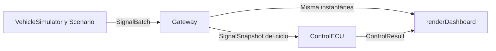

# Vehicle ECU Simulator

Proyecto en C++17 para simular el flujo de señales de un vehículo. El simulador produce lecturas correlacionadas a partir de un guion de conducción y fallas. La Gateway califica las seis señales y publica una instantánea por ciclo. La ECU de Control lee esa instantánea y decide el estado, el diagnóstico y la acción simulada. El Dashboard presenta la misma instantánea junto con el resultado de Control. El coordinador ejecuta el recorrido con ciclos lógicos, sin depender de un reloj real.

## Compilación y pruebas

Ejecuta estos comandos desde la raíz del proyecto en un shell POSIX. Se requiere CMake 3.16 o posterior y un compilador C++17.

```sh
cmake -S . -B build -DCMAKE_BUILD_TYPE=Debug -DBUILD_TESTING=ON
cmake --build build --config Debug
(cd build && ctest -C Debug --output-on-failure)
```

Con un generador de configuración única, la sintaxis del ejecutable es `./build/vehicle-ecu-simulator [nominal|faults] [--dashboard auto|ascii|braille]`. Por ejemplo, puedes ejecutar el recorrido nominal con el formato automático, guardar un registro ASCII o solicitar los relojes braille explícitamente.

```sh
./build/vehicle-ecu-simulator nominal
./build/vehicle-ecu-simulator faults --dashboard ascii > fallas.txt
./build/vehicle-ecu-simulator faults --dashboard braille
```

El escenario predeterminado es `nominal` y el formato predeterminado es `auto`. En macOS y Linux, `auto` selecciona braille si la salida es una terminal de al menos 80 columnas y la configuración regional indica UTF-8. Usa ASCII en una terminal más estrecha, al redirigir la salida o si la capacidad de la terminal no puede confirmarse. En otros entornos, la selección automática usa ASCII. La opción explícita `--dashboard braille` genera UTF-8 incluso con la salida redirigida.

El ejecutable devuelve 0 cuando completa el guion, incluso si el escenario activa `SAFE_STATE`. Con un generador multiconfiguración, usa el ejecutable de la configuración compilada, por ejemplo `build/Debug/vehicle-ecu-simulator`.

## Arquitectura



`runScenario` posee los componentes durante la ejecución y entrega al observador la instantánea que acaba de evaluar Control. El Dashboard lee esa misma instancia durante su llamada. El núcleo usa almacenamiento de capacidad fija. El texto y la codificación de terminal pertenecen a `ecu_dashboard`.

| Componente | Responsabilidad |
| --- | --- |
| `SignalDescriptor`, `SignalSample` y `SignalObservation` | Metadatos, muestra y observación con calidad y edad. |
| `VehicleSimulator` y `Scenario` | Planta correlacionada, conducción e inyección por ciclo. |
| `Gateway` | Validación y conservación de señales, publicación de instantáneas. |
| `ControlECU` | Diagnósticos, máquina de estados y acción simulada. |
| `renderDashboard` | Vistas ASCII y braille del ciclo y del resultado de Control. |
| `runScenario` y `main` | Orden del recorrido, selección del escenario y salida. |

## Estructura del repositorio

```text
vehicle-ecu-simulator/
├── CMakeLists.txt
├── README.md
├── .github/workflows/ci.yml
├── include/ecu/          Contratos públicos de señales y componentes
├── src/                 Implementaciones y ejecutable de terminal
├── tests/               Pruebas de componentes, integración y consumidor CMake
└── benchmarks/          Instrumento de medida y muestras crudas
```

Los targets `ecu_gateway`, `ecu_control`, `ecu_simulator` y `ecu_dashboard` permiten construir y verificar cada responsabilidad. El requisito C++17 se propaga a los consumidores mediante la interfaz pública de CMake.

## STL utilizado

| Elemento                                      | Uso                                                                                     |
| --------------------------------------------- | --------------------------------------------------------------------------------------- |
| `std::array`                                  | Catálogo, lotes, instantáneas, diagnósticos y agendas con capacidad fija.               |
| `std::optional`                               | Ausencia de muestras, reemplazos de falla y operaciones rechazadas.                     |
| `std::string_view` y `std::string`            | Etiquetas y texto de presentación.                                                      |
| `std::clamp` y `std::max`                     | Evolución acotada de velocidad y régimen nominal.                                       |
| `std::ostringstream` y `std::locale::classic` | Valores numéricos del Dashboard con formato independiente de la configuración regional. |
| `std::chrono::steady_clock`                   | Medición de rendimiento con reloj monotónico.                                           |
| `std::vector`                                 | Captura de la traza del benchmark, preparada antes del intervalo medido.                |

## Contrato de señales

| ID                    | Señal                        | Unidad | Rango inclusivo | Omisiones toleradas |
| --------------------- | ---------------------------- | ------ | --------------- | ------------------- |
| `speed`               | Velocidad                    | km/h   | 0 a 250         | 3                   |
| `engine_rpm`          | Régimen del motor            | rpm    | 0 a 8000        | 3                   |
| `coolant_temperature` | Temperatura del refrigerante | °C     | −40 a 150       | 3                   |
| `throttle_position`   | Posición del acelerador      | %      | 0 a 100         | 3                   |
| `battery_voltage`     | Voltaje de batería           | V      | 9 a 16          | 3                   |
| `oil_pressure`        | Presión de aceite            | bar    | 0 a 10          | 3                   |

El catálogo fija la unidad, el rango de aceptación de la muestra y la tolerancia temporal de cada señal. La API representa °C con la cadena ASCII `degC`. Los rangos y plazos son parámetros de la simulación. El catálogo se verifica en compilación para asegurar que los IDs coincidan con sus posiciones, las unidades existan y los límites sean finitos y estén ordenados.

### Recepción y ciclos

1. El productor prepara un `SignalBatch` para un ciclo y añade lecturas con `add(id, value)`. El resultado de la primera inserción de un ID conocido es `inserted`, independientemente de la calidad del valor.
2. Si un ID aparece dos o más veces, el lote descarta todas sus lecturas y devuelve `duplicate_id` desde la segunda ocurrencia. La Gateway conserva la muestra anterior y su ciclo de recepción, si existen. Un ID desconocido devuelve `unknown_id` y se descarta. Los demás canales se procesan normalmente. La instantánea publica un indicador de ID desconocido y marcas de duplicado por señal para el lote aceptado.
3. `Gateway::snapshot()` consulta la última instantánea publicada. Al arrancar devuelve el estado inicial del ciclo 0. `Gateway::processCycle(cycle, batch)` acepta ciclos estrictamente mayores al último, incluso con un lote vacío. Un ciclo repetido o anterior devuelve `std::nullopt` y conserva el estado y los diagnósticos. Si hay un salto, la edad refleja la distancia entre los números de ciclo. Cada muestra del lote aceptado se registra con ese ciclo.
4. `SignalSnapshot::observe(id)` devuelve una observación para cada ID conocido y `std::nullopt` para un ID desconocido. Una observación de arranque tiene frescura `never_received`, sin muestra ni edad.

### Calidad y frescura

Una recepción única registra el valor crudo, su calidad y el ciclo de recepción. Los valores finitos dentro del intervalo, incluidos sus extremos, son `in_range`. Los valores finitos fuera del intervalo son `out_of_range`. NaN y ambos infinitos son `non_finite`. Una muestra inválida puede ser reciente.

| Frescura         | Condición                                                                                                  |
| ---------------- | ---------------------------------------------------------------------------------------------------------- |
| `never_received` | El ID conocido todavía carece de muestra.                                                                  |
| `fresh`          | La última muestra se recibió en el ciclo actual. Edad 0.                                                   |
| `retained`       | Hay una muestra anterior con edad de 1 a 3 ciclos en el catálogo inicial.                                  |
| `expired`        | La edad supera la tolerancia. La última muestra sigue disponible para diagnóstico con su calidad original. |

Por ejemplo, una muestra recibida en el ciclo 10 queda retenida del 11 al 13 si faltan actualizaciones y caduca en el 14. Una nueva recepción única vuelve a tener edad 0 y obtiene su propia calidad. Control usa la calidad y la frescura para decidir si limita o inhibe la operación.

## Propiedad de los datos

La Gateway mantiene un único estado de señales de capacidad fija. Al aceptar un ciclo, publica por valor una copia de ese estado junto con el número de ciclo y el diagnóstico de entrada. Los lotes y las instantáneas usan almacenamiento fijo y el camino de procesamiento no asigna memoria dinámica. Una instantánea que el llamador conserve mantiene sus datos tras procesar el siguiente ciclo.

`ControlECU::step(const SignalSnapshot&)` lee las observaciones durante la llamada y devuelve un resultado propio por valor. El resultado contiene `cycle`, `state`, `action`, `diagnostics` del ciclo y `latchedFault` si hay una causa enclavada. Control conserva su estado y su diagnóstico de enclavamiento, sin reconstruir el arreglo de señales. El coordinador entrega al observador esa misma instantánea junto con el resultado de Control. Los diagnósticos de entrada, como duplicados e IDs desconocidos, siguen disponibles en la instantánea de la Gateway.

## ECU de Control

### Máquina de estados

| Estado        | Acción simulada | Política                                                                                                                                                                                                                                                                                                                                                                                                      |
| ------------- | --------------- | ------------------------------------------------------------------------------------------------------------------------------------------------------------------------------------------------------------------------------------------------------------------------------------------------------------------------------------------------------------------------------------------------------------- |
| `INIT`        | Inhibida        | El primer ciclo aceptado inicia la ventana de arranque en `t0`. Un ciclo sin hallazgos permite pasar de inmediato a `OPERATIONAL`. Ante un hallazgo degradante, espera durante `t0` y `t0 + 1`. Desde `t0 + 2`, la ausencia de un canal crítico nunca recibido provoca `SAFE_STATE`. Los demás hallazgos degradantes provocan `DEGRADED`. Un hallazgo crítico activa `SAFE_STATE` incluso en el primer ciclo. |
| `OPERATIONAL` | Normal          | Una condición degradante limita la operación. Una condición crítica inhibe la operación y enclava `SAFE_STATE`.                                                                                                                                                                                                                                                                                               |
| `DEGRADED`    | Limitada        | Regresa a `OPERATIONAL` con dos ciclos sanos consecutivos. El primero publica `recovery_pending`. Una nueva falla o un salto en la secuencia interrumpe la confirmación. Una condición crítica enclava `SAFE_STATE`.                                                                                                                                                                                          |
| `SAFE_STATE`  | Inhibida        | Conserva la causa y el ciclo que originaron el enclavamiento. Sigue publicando hallazgos actuales aunque cambien o desaparezcan.                                                                                                                                                                                                                                                                              |

Control acepta ciclos positivos estrictamente crecientes. Si la instantánea es del ciclo 0, se repite o retrocede, `step` devuelve `std::nullopt` sin cambiar el estado ni la confirmación de recuperación. `reset()` solo actúa en `SAFE_STATE`. Vuelve a `INIT`, conserva el último ciclo procesado y comienza una nueva ventana con la siguiente instantánea aceptada.

### Política diagnóstica

Los umbrales son parámetros del escenario simulado. La Gateway decide la calidad de cada medición. Control evalúa su aptitud para operar y ejecuta los monitores con sus propias precondiciones. Un umbral operativo se aplica a la muestra fresca y válida de su propia señal. La calidad inválida se sigue diagnosticando mientras la muestra está retenida. Al expirar, el diagnóstico activo de esa señal indica caducidad.

| Monitor                         | Condición y severidad                                                                                                                                                                                        |
| ------------------------------- | ------------------------------------------------------------------------------------------------------------------------------------------------------------------------------------------------------------ |
| Temperatura y presión de aceite | Crítica si la muestra caducó o su calidad es inválida. Una muestra retenida con calidad válida degrada. Si el canal nunca se recibió, su ausencia se vuelve crítica al terminar la ventana de arranque.      |
| Temperatura operativa           | Crítica por encima de 110 °C. La medición puede quedar dentro del rango de Gateway y activar este diagnóstico.                                                                                               |
| Presión de aceite operativa     | Crítica por debajo de 0,8 bar salvo que una muestra fresca y válida de RPM sea menor de 500 y confirme el motor detenido en el modelo. La falta de RPM aptas no confirma esa condición.                      |
| Voltaje de batería              | Degradante con una muestra fresca y válida fuera del intervalo inclusivo de 11,5 a 15 V, o si falta una muestra fresca y válida.                                                                             |
| Velocidad, RPM y acelerador     | Degradante cuando falta una muestra fresca y válida del canal.                                                                                                                                               |
| Plausibilidad de marcha fija    | Crítica si, con velocidad de al menos 20 km/h y acelerador de al menos 20 %, las RPM están fuera de la banda inclusiva de 30 a 60 RPM por km/h. Requiere que las tres muestras estén frescas y sean válidas. |

Control evalúa los monitores independientemente, de modo que una falla de batería no oculta una incoherencia de marcha. Un hallazgo crítico tiene prioridad sobre uno degradante. Para el enclavamiento se elige el primer hallazgo crítico en orden fijo. Primero se revisan calidad, frescura y límites de temperatura y batería en orden de catálogo. Después se evalúan el límite operativo de aceite y la plausibilidad de marcha.

## Simulador y escenarios

### Modelo nominal

`VehicleSimulator::step(pedal)` avanza la planta 0,5 s simulados. El pedal se expresa en porcentaje entre 0 y 100. Un valor fuera de ese intervalo o no finito se rechaza sin alterar la planta. El modelo usa un paso fijo y prescinde de números aleatorios.

| Señal              | Cálculo nominal por ciclo                                                                                                                               |
| ------------------ | ------------------------------------------------------------------------------------------------------------------------------------------------------- |
| Acelerador         | Valor del pedal programado para el ciclo.                                                                                                               |
| Velocidad          | Se aproxima al objetivo de `1.2 * pedal` km/h, con una tasa máxima de aumento de 8 (km/h)/s y de descenso de 12 (km/h)/s.                               |
| RPM                | `max(800, 45 * velocidad)` para una marcha fija simplificada con un mínimo de ralentí.                                                                  |
| Temperatura        | Empieza en 25 °C y avanza hacia `72 + 0.24 * pedal` °C. En cada ciclo recorre el 3 % de la diferencia restante, con un coeficiente de 0,06 por segundo. |
| Presión de aceite  | `1.2 + 0.0005 * RPM` bar.                                                                                                                               |
| Voltaje de batería | `13.6 + 0.00004 * RPM - 0.0025 * pedal` V.                                                                                                              |

### Guion e inyección de fallas

Un `Scenario` admite hasta 16 tramos de pedal mediante `addDriveSegment(fin, pedal)`. El recorrido empieza en el ciclo 1 y cada tramo comienza inmediatamente después del fin inclusivo del anterior. El último tramo fija la duración. `addFault(evento)` agrega hasta 32 eventos con ID de señal, ciclo inicial, ciclo final y reemplazo opcional. Ambos límites de la falla son inclusivos.

- Un reemplazo presente sustituye el valor emitido. Puede representar una medición fuera de rango o no finita para ejercitar la validación de Gateway. Un reemplazo vacío omite la lectura durante la falla.
- Se permiten fallas simultáneas sobre señales distintas. Los intervalos superpuestos para un mismo ID, las fallas fuera del recorrido y los IDs desconocidos se rechazan sin cambiar el guion.
- La inyección afecta el lote que recibe Gateway. La planta sigue calculando su trayectoria nominal y, al terminar la falla, la señal vuelve al valor nominal del ciclo correspondiente.

### Recorrido integrado

`runScenario(scenario, observer)` ejecuta el recorrido completo por orden de ciclo con un simulador, una Gateway y un Control nuevos en cada ejecución. Durante cada llamada, el observador recibe por referencia de solo lectura la misma instantánea que leyó Control y su decisión para ese ciclo. El recorrido continúa hasta el final del guion aunque se active `SAFE_STATE`. No hay pausas ni consultas al reloj.

Los escenarios `nominal` y `faults` duran 42 ciclos. Ambos programan un pedal de 0 %, 50 %, 25 % y 0 % en tramos que terminan en los ciclos 4, 22, 32 y 42, respectivamente. El escenario `nominal` mantiene la operación normal. El guion `faults` añade estos eventos.

| Ciclos | Inyección                            | Comportamiento esperado                                                                                                                       |
| ------ | ------------------------------------ | --------------------------------------------------------------------------------------------------------------------------------------------- |
| 5      | Omite la batería.                    | `DEGRADED` en 5 y 6. El ciclo 6 inicia la confirmación y Control vuelve a `OPERATIONAL` en 7.                                                 |
| 9–10   | Sustituye el acelerador por 120 %.   | Gateway detecta una lectura fuera de rango. `DEGRADED` de 9 a 11 y `OPERATIONAL` en 12.                                                       |
| 14–17  | Omite las seis lecturas.             | `DEGRADED` de 14 a 16. En 17 caducan las muestras y Control enclava `SAFE_STATE`. Las lecturas vuelven en 18 y el estado permanece enclavado. |
| 20     | Sustituye la temperatura por 130 °C. | Control detecta sobretemperatura como hallazgo actual. La causa enclavada sigue siendo la del ciclo 17.                                       |

## Dashboard de terminal

`renderDashboard(out, snapshot, result, format, columns)`, declarado en `ecu/dashboard.hpp`, recibe por referencia de solo lectura la instantánea y el resultado de Control del observador. Consulta cada señal durante el renderizado, sin retener referencias ni duplicar el arreglo de señales. Devuelve `false` si los ciclos difieren o el flujo de salida indica un error.

| Formato   | Presentación                                                                                                                                                                             |
| --------- | ---------------------------------------------------------------------------------------------------------------------------------------------------------------------------------------- |
| `ascii`   | Tabla de seis señales con valor, unidad, calidad, frescura y edad en ciclos. En terminales de ancho conocido inferior a 80 columnas, presenta cada señal por campos en líneas separadas. |
| `braille` | Relojes UTF-8 de velocidad y RPM seguidos de la misma tabla. Cada reloj dibuja su aguja únicamente si la lectura está fresca y es válida.                                                |

La calidad de la última muestra y su frescura aparecen en campos independientes. Una muestra retenida o caducada conserva su valor para diagnóstico, con la antigüedad visible y la marca `RETENIDA` o `CADUCADA`. Si la señal nunca se recibió, el valor y la edad se muestran como ausentes. Los valores no finitos aparecen como `nan`, `+inf` o `-inf`.

La sección de Control muestra el estado, la acción simulada y todos los diagnósticos del ciclo. La causa y el ciclo originales del enclavamiento aparecen por separado. En el ciclo 18 de `faults`, las señales recuperan su frescura y Control sigue en `SAFE_STATE` con la causa del ciclo 17. En el 20, la sobretemperatura aparece como diagnóstico activo junto a esa misma causa enclavada. Ambos formatos escriben un cuadro por ciclo en secuencia, sin códigos ANSI ni pausas.

## Cobertura de pruebas

| ID       | Comportamiento comprobado                                                                                                                                                       | Caso de CTest               |
| -------- | ------------------------------------------------------------------------------------------------------------------------------------------------------------------------------ | --------------------------- |
| GW-01    | Exponer las seis señales con sus unidades y límites. Aceptar ambos extremos como válidos y distinguir valores finitos fuera de rango y valores no finitos.                     | `gateway.catalog_and_range` |
| GW-02    | Representar la ausencia inicial, conservar la última muestra y su calidad durante omisiones, caducar al superar la tolerancia y recalificar al recibir una nueva muestra.      | `gateway.freshness`         |
| GW-03    | Diagnosticar IDs desconocidos y duplicados. Descartar las ocurrencias duplicadas independientemente de su orden, sin renovar su edad ni impedir que se procesen otros canales. | `gateway.malformed_batch`   |
| GW-04    | Publicar una instantánea autocontenida que pueda conservarse sin alias al estado interno de la Gateway.                                                                        | `gateway.snapshot`          |
| GW-05    | Procesar un lote por ciclo lógico creciente, calcular la edad a través de saltos y conservar el estado cuando se rechaza un ciclo.                                             | `gateway.cycle_order`       |
| CTRL-01  | Inhibir durante el arranque cuando faltan datos, operar al recibir un ciclo sano y detectar una falla crítica desde el primer ciclo.                                           | `control.startup`           |
| CTRL-02  | Limitar la operación ante un hallazgo degradante y exigir dos ciclos sanos consecutivos para recuperarse.                                                                      | `control.degradation`       |
| CTRL-03  | Evaluar los límites de operación y distinguir la falta de una muestra de su caducidad.                                                                                         | `control.operating_limits`  |
| CTRL-04  | Evaluar fallas simultáneas y resolver el enclavamiento con prioridad y desempate deterministas.                                                                                | `control.concurrent_faults` |
| CTRL-05  | Retener la causa y el ciclo originales al inhibir en `SAFE_STATE`, y volver a `INIT` con un reinicio explícito.                                                                | `control.safe_latch`        |
| CTRL-06  | Rechazar ciclos inválidos sin modificar el estado ni contar para la recuperación.                                                                                              | `control.cycle_order`       |
| SIM-01   | Producir lecturas nominales correlacionadas y rechazar pedales inválidos sin avanzar la planta.                                                                                | `simulation.nominal`        |
| SIM-02   | Aplicar omisiones y reemplazos en sus intervalos exactos, conservar la trayectoria nominal y rechazar una agenda ambigua.                                                      | `simulation.fault_schedule` |
| SIM-03   | Ejecutar el flujo completo por ciclo y reproducir los estados y diagnósticos de los recorridos nominal y con fallas.                                                           | `simulation.integration`    |
| SIM-04   | Ejecutar el escenario con fallas desde la línea de comandos hasta completar el guion.                                                                                          | `simulation.cli_faults`     |
| DASH-01  | Presentar las seis señales en ASCII con calidad, frescura y edad independientes, incluidos valores ausentes y no finitos.                                                      | `dashboard.ascii`           |
| DASH-02  | Dibujar ambos relojes braille y conservar la tabla de señales y el resultado de Control. Mostrar agujas solo para lecturas frescas y válidas.                                  | `dashboard.braille`         |
| DASH-03  | Renderizar ambas vistas sobre la instantánea y el resultado del mismo ciclo durante el guion real, diferenciando diagnósticos activos y causa enclavada.                       | `dashboard.pipeline`        |
| BUILD-01 | Propagar C++17 y las dependencias de enlace a un consumidor externo que solicita un estándar anterior.                                                                         | `build.consumer`            |

## Pruebas y CI

La validación local utiliza macOS 26.5 arm64, AppleClang 21.0.0 y CMake 4.4.4, con advertencias tratadas como errores.

| Configuración | Resultado local |
| --- | --- |
| Debug | 19/19 pruebas CTest aprobadas. |
| Release, benchmark habilitado | 19/19 pruebas CTest aprobadas. |
| Debug con AddressSanitizer y UndefinedBehaviorSanitizer | 19/19 pruebas CTest aprobadas. |

La prueba `build.consumer` crea un proyecto externo que solicita C++11, incluye las seis cabeceras públicas y enlaza las bibliotecas. CMake eleva su estándar a C++17 mediante el requisito público del target. El consumidor ejecuta un ciclo y renderiza el resultado.

Cppcheck 2.22.0 verifica `src/` y `benchmarks/` sin diagnósticos de tipo warning, performance o portability.

El [workflow de CI](.github/workflows/ci.yml) configura compilación y pruebas en Debug y Release para Linux, macOS y Windows, además de ASan y UBSan en Linux.

## Rendimiento

El benchmark mide por separado el núcleo y los formatos ASCII y braille del Dashboard con el escenario `faults`. Para compilar el instrumento de medición, habilita `ECU_BUILD_BENCHMARKS=ON` en Release.

## Alcance

El sistema integra el simulador, Gateway, Control, el coordinador de escenarios, el Dashboard de terminal y sus pruebas en CTest. El ciclo representa tiempo simulado y las acciones de Control se publican como parte de su resultado. La cadencia física de muestreo y cualquier adaptador de bus requieren contratos propios.
