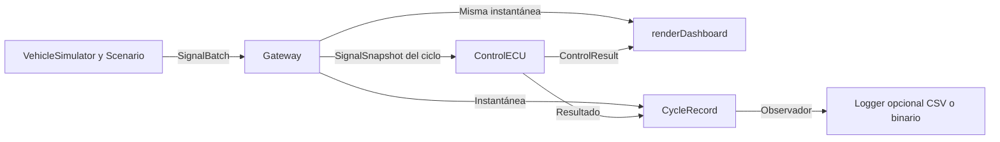

# Vehicle ECU Simulator

Proyecto en C++17 para simular el flujo de señales de un vehículo. El simulador produce lecturas correlacionadas a partir de un guion de conducción y fallas. La Gateway califica las seis señales y publica una instantánea por ciclo. La ECU de Control lee esa instantánea y decide el estado, el diagnóstico y la acción simulada. El Dashboard presenta la misma instantánea junto con el resultado de Control. El coordinador ejecuta el recorrido con ciclos lógicos, sin depender de un reloj real.

Gateway publica `VALID`, `INVALID` y `MISSING` con una antigüedad máxima configurable por instancia. Cada instantánea conserva esa política temporal. Control administra el arranque, el autoexamen, la operación, la degradación, el estado seguro y el apagado.

El módulo de escalamiento convierte temperatura y voltaje de batería entre unidades físicas y códigos enteros sin signo. Expone los límites representables y el resultado de saturación, sin modificar las mediciones ni las decisiones de las ECU.

Los loggers CSV y binario guardan las observaciones de Gateway y el resultado de Control de cada ciclo. Ambos lectores recuperan un `CycleRecord`. [Registro CSV](docs/registro_csv.md) · [Registro binario](docs/registro_binario.md)

## Compilación y pruebas

Ejecuta estos comandos desde la raíz del proyecto en un shell POSIX. Se requiere CMake 3.16 o posterior y un compilador C++17.

```sh
cmake -S . -B build -DCMAKE_BUILD_TYPE=Debug -DBUILD_TESTING=ON
cmake --build build --config Debug
(cd build && ctest -C Debug --output-on-failure)
```

Con un generador de configuración única, el ejecutable admite `./build/vehicle-ecu-simulator [nominal|faults|battery-fault|oil-fault|temperature-dropout] [--dashboard auto|ascii|braille] [--csv ARCHIVO | --binary ARCHIVO]`.

```sh
./build/vehicle-ecu-simulator nominal
./build/vehicle-ecu-simulator faults --dashboard ascii > fallas.txt
./build/vehicle-ecu-simulator faults --dashboard braille
./build/vehicle-ecu-simulator battery-fault --dashboard ascii
./build/vehicle-ecu-simulator oil-fault --dashboard ascii
./build/vehicle-ecu-simulator temperature-dropout --dashboard ascii
./build/vehicle-ecu-simulator faults --csv "recorrido con fallas.csv"
./build/vehicle-ecu-simulator faults --binary "recorrido con fallas.bin"
```

El escenario predeterminado es `nominal` y el formato predeterminado es `auto`. En macOS y Linux, `auto` selecciona braille si la salida es una terminal de al menos 80 columnas y la configuración regional indica UTF-8. Usa ASCII en una terminal más estrecha, al redirigir la salida o si la capacidad de la terminal no puede confirmarse. En otros entornos, la selección automática usa ASCII. La opción explícita `--dashboard braille` genera UTF-8 incluso con la salida redirigida.

El ejecutable devuelve 0 cuando completa el guion y publica `SHUTDOWN`, incluso si el escenario activó `SAFE_STATE`. Una falla simulada se comunica mediante los resultados de Control; un error de ejecución o de salida produce un código distinto de cero. Con un generador multiconfiguración, usa el ejecutable de la configuración compilada, por ejemplo `build/Debug/vehicle-ecu-simulator`.

## Arquitectura



`runScenario` posee los componentes durante la ejecución y entrega al observador la instantánea que acaba de evaluar Control. El Dashboard lee esa misma instancia durante su llamada. El núcleo usa almacenamiento de capacidad fija. El texto y la codificación de terminal pertenecen a `ecu_dashboard`.

| Componente | Responsabilidad |
| --- | --- |
| `SignalDescriptor`, `SignalSample` y `SignalObservation` | Metadatos, muestra y observación con resultado de Gateway, calidad y edad. |
| `GatewayConfig` | Límite de antigüedad común a las seis señales de una Gateway. |
| `VehicleSimulator` y `Scenario` | Planta correlacionada, conducción e inyección por ciclo. |
| `Gateway` | Validación y conservación de señales, publicación de instantáneas. |
| `ControlECU` | Diagnósticos, máquina de estados y acción simulada. |
| `LinearScale`, `encodePhysical` y `decodeRaw` | Conversión física/cruda, cuantización y saturación explícita. |
| `renderDashboard` | Vistas ASCII y braille del ciclo y del resultado de Control. |
| `CycleRecord` y `recordObserver` | Captura del mismo ciclo para un destino de registros. |
| `CsvWriter` y `CsvReader` | Escritura y lectura del registro en CSV mediante flujos C++. |
| `BinaryWriter` y `BinaryReader` | Escritura y lectura del registro binario versionado con CRC por ciclo. |
| `runScenario` y `main` | Orden del recorrido, selección del escenario y salida. |

## Estructura del repositorio

```text
vehicle-ecu-simulator/
├── CMakeLists.txt
├── README.md
├── .github/workflows/ci.yml
├── include/ecu/          Contratos públicos de señales y componentes
├── src/                 Implementaciones y ejecutable de terminal
├── tests/               Pruebas de componentes, integración y consumidor CMake
├── docs/                Decisiones técnicas, eficiencia, escalamiento y formatos de registro
└── benchmarks/          Instrumento de medida y muestras crudas
```

Los targets `ecu_gateway`, `ecu_control`, `ecu_simulator`, `ecu_dashboard` y `ecu_scaling` permiten construir y verificar cada responsabilidad. `ecu_scaling` proporciona funciones puras independientes del procesamiento de Gateway y Control. El requisito C++17 se propaga a los consumidores mediante la interfaz pública de CMake.

`ecu_record` expone el registro común. `ecu_csv` y `ecu_binary` proporcionan los lectores y escritores de sus formatos y enlazan el registro como dependencia pública.

## STL utilizado

| Elemento                                      | Uso                                                                                     |
| --------------------------------------------- | --------------------------------------------------------------------------------------- |
| `std::array`                                  | Catálogo, lotes, instantáneas, diagnósticos y agendas con capacidad fija.               |
| `std::optional`                               | Ausencia de muestras, reemplazos de falla y operaciones rechazadas.                     |
| `std::string_view` y `std::string`            | Etiquetas y texto de presentación.                                                      |
| `std::clamp` y `std::max`                     | Evolución acotada de velocidad y régimen nominal.                                       |
| `std::for_each` y lambda                     | Procesar las recepciones del catálogo con una única regla de validación en Gateway.      |
| `std::count_if` y predicado                  | Contar resultados de Gateway consultando las observaciones de la instantánea.             |
| `std::find_if` y predicados                  | Seleccionar el primer diagnóstico crítico y localizar el tramo de conducción del ciclo.  |
| `std::any_of` y predicado                    | Rechazar una falla cuyo intervalo se solape con otro del mismo canal.                     |
| `std::ostringstream` y `std::locale::classic` | Valores numéricos del Dashboard con formato independiente de la configuración regional. |
| `std::chrono::steady_clock`                   | Medición de rendimiento con reloj monotónico.                                           |
| `std::vector`                                 | Captura de la traza del benchmark, preparada antes del intervalo medido.                |

La búsqueda de señales por ID conserva el acceso directo O(1); los algoritmos de búsqueda se aplican donde existe un recorrido por condición. La validación de un lote y el conteo de resultados son O(n), con O(1) de memoria auxiliar. El [análisis de eficiencia](docs/eficiencia.md) distingue esos costos del almacenamiento O(n), explica los cambios y compara los contenedores considerados.

## Contrato de señales

| ID                    | Señal                        | Unidad | Rango inclusivo |
| --------------------- | ---------------------------- | ------ | --------------- |
| `speed`               | Velocidad                    | km/h   | 0 a 250         |
| `engine_rpm`          | Régimen del motor            | rpm    | 0 a 8000        |
| `coolant_temperature` | Temperatura del refrigerante | °C     | −40 a 150       |
| `throttle_position`   | Posición del acelerador      | %      | 0 a 100         |
| `battery_voltage`     | Voltaje de batería           | V      | 9 a 16          |
| `oil_pressure`        | Presión de aceite            | bar    | 0 a 10          |

El catálogo fija la unidad y el rango de aceptación de cada señal. La API representa °C con la cadena ASCII `degC`. El catálogo se verifica en compilación para asegurar que los IDs coincidan con sus posiciones, las unidades existan y los límites sean finitos y estén ordenados. La antigüedad máxima pertenece a `GatewayConfig`, separada de los metadatos estáticos del catálogo.

### Antigüedad configurable

`GatewayConfig::maxAgeCycles` define el límite inclusivo de edad para las seis señales de una instancia. La edad se calcula como `ciclo_actual - ciclo_ultima_recepcion`; la muestra caduca únicamente cuando `edad > maxAgeCycles`. `Gateway{}` usa tres ciclos. También puede elegirse otra política al construirla:

```cpp
#include "ecu/gateway.hpp"

ecu::Gateway gateway{ecu::GatewayConfig{1}};
ecu::SignalBatch batch;
batch.add(ecu::SignalId::coolant_temperature, 90.0);

const auto received = gateway.processCycle(10, batch);              // VALID, fresca, edad 0
const auto retained = gateway.processCycle(11, ecu::SignalBatch{}); // VALID, retenida, edad 1
const auto expired = gateway.processCycle(12, ecu::SignalBatch{});  // MISSING, caducada, edad 2
// received->observe(ecu::SignalId::coolant_temperature)->status == ecu::SignalStatus::valid
// expired->config().maxAgeCycles == 1
```

La configuración usa `Cycle` (`uint64_t`): cero exige recibir una muestra en el ciclo actual; el máximo representable también es válido. No se suma el límite al ciclo de recepción, por lo que esa suma no puede desbordarse. La configuración se copia al construir Gateway y se conserva por valor en cada instantánea. Modificar el objeto de configuración original, reemplazar o destruir Gateway no altera una instantánea guardada. `SignalSnapshot::config()` devuelve una copia de la política aplicada.

`runScenario` y la CLI siguen utilizando el valor predeterminado de tres ciclos. Para migrar código que consultaba `SignalDescriptor::toleratedMissingCycles`, usar `snapshot.config().maxAgeCycles`: el límite ahora es una política de instancia común a todas las señales.

### Recepción y ciclos

1. El productor prepara un `SignalBatch` para un ciclo y añade lecturas con `add(id, value)`. El resultado de la primera inserción de un ID conocido es `inserted`, independientemente de la calidad del valor.
2. Si un ID aparece dos o más veces, el lote descarta todas sus lecturas y devuelve `duplicate_id` desde la segunda ocurrencia. La Gateway conserva la muestra anterior y su ciclo de recepción, si existen. Un ID desconocido devuelve `unknown_id` y se descarta. Los demás canales se procesan normalmente. La instantánea publica un indicador de ID desconocido y marcas de duplicado por señal para el lote aceptado.
3. `Gateway::snapshot()` consulta la última instantánea publicada. Al arrancar devuelve el estado inicial del ciclo 0. `Gateway::processCycle(cycle, batch)` acepta ciclos estrictamente mayores al último, incluso con un lote vacío. Un ciclo repetido o anterior devuelve `std::nullopt` y conserva el estado y los diagnósticos. Si hay un salto, la edad refleja la distancia entre los números de ciclo. Cada muestra del lote aceptado se registra con ese ciclo.
4. `SignalSnapshot::observe(id)` devuelve una observación para cada ID conocido y `std::nullopt` para un ID desconocido. Una observación de arranque tiene resultado `missing` y frescura `never_received`, sin muestra ni edad. Un ID desconocido no es una señal conocida con resultado `MISSING`.

### Calidad y frescura

Una recepción única registra el valor recibido en unidades físicas, su calidad y el ciclo de recepción. Los valores finitos dentro del intervalo, incluidos sus extremos, son `in_range`. Los valores finitos fuera del intervalo son `out_of_range`. NaN y ambos infinitos son `non_finite`. Una muestra inválida puede ser reciente.

| Frescura         | Condición                                                                                                  |
| ---------------- | ---------------------------------------------------------------------------------------------------------- |
| `never_received` | El ID conocido todavía carece de muestra.                                                                  |
| `fresh`          | La última muestra se recibió en el ciclo actual. Edad 0.                                                   |
| `retained`       | Hay una muestra anterior con edad de 1 a `maxAgeCycles`, inclusive.                                        |
| `expired`        | La edad supera la tolerancia. La última muestra sigue disponible para diagnóstico con su calidad original. |

Con la configuración predeterminada, una muestra recibida en el ciclo 10 queda retenida del 11 al 13 si faltan actualizaciones y caduca en el 14. Una nueva recepción única, aunque sea inválida o tenga el mismo valor anterior, vuelve a tener edad 0 y obtiene su propia calidad. Una omisión, un duplicado descartado o un ciclo rechazado no renueva la recepción. Control usa la calidad y la frescura para decidir si limita o inhibe la operación.

### Resultado de Gateway

`SignalObservation::status` publica el resultado mediante `SignalStatus`. Se calcula en `SignalSnapshot::observe`, sin duplicar la validación de rangos en Dashboard ni en los consumidores.

| API C++ | Dashboard | Condición |
| --- | --- | --- |
| `SignalStatus::valid` | `VALID` | Muestra vigente con calidad `in_range`, fresca o retenida dentro del límite. |
| `SignalStatus::invalid` | `INVALID` | Muestra vigente con calidad `out_of_range` o `non_finite`. |
| `SignalStatus::missing` | `MISSING` | Nunca se recibió una muestra o su edad supera el límite. |

La caducidad tiene prioridad sobre la calidad para este resultado. Por ejemplo, una temperatura de 180 °C pasa de `INVALID` a `MISSING` al vencer el plazo; conserva 180 °C y `out_of_range` para diagnóstico. Recibir 90 °C la devuelve a `VALID`; recibir nuevamente 180 °C la devuelve a `INVALID` con edad cero.

El resultado no expresa criticidad ni ordena transiciones de Control. Una señal `VALID` pero retenida puede seguir degradando la operación según la política conservadora actual de Control. Del mismo modo, recuperar una señal no elimina el enclavamiento de `SAFE_STATE`.

Caso de referencia con `maxAgeCycles = 3`, muestra válida recibida en el ciclo 10 y ninguna recepción posterior:

| Ciclo | Edad | Frescura | Resultado |
| --- | --- | --- | --- |
| 10 | 0 | `fresh` | `VALID` |
| 11 | 1 | `retained` | `VALID` |
| 12 | 2 | `retained` | `VALID` |
| 13 | 3 | `retained` | `VALID` |
| 14 | 4 | `expired` | `MISSING` |

### Conteo por resultado

`SignalSnapshot::count(SignalStatus)` devuelve el número de señales conocidas que tienen ese resultado en el ciclo de la instantánea. Consulta las mismas observaciones que usa Control, por lo que aplica la configuración temporal y conserva la precedencia de `MISSING` sobre la calidad de una muestra caducada.

```cpp
ecu::Gateway gateway;
const auto initial = gateway.snapshot();
const auto valid = initial.count(ecu::SignalStatus::valid);     // 0
const auto invalid = initial.count(ecu::SignalStatus::invalid); // 0
const auto missing = initial.count(ecu::SignalStatus::missing); // 6
```

Los conteos de los tres resultados suman `signalCount`. Una muestra válida retenida sigue sumando en `VALID`; una muestra inválida caducada pasa a sumar en `MISSING`. Contar no modifica la instantánea ni recalifica el dato mediante otra regla de rango. Cada consulta recorre el catálogo con `std::count_if`, sin crear una colección temporal ni mantener una caché de contadores.

## Escalamiento físico/crudo

`ecu/scaling.hpp` define la conversión `fisico = crudo * factor + offset` y su inversa. Los perfiles disponibles tienen factores, offsets y anchos distintos:

| Señal | Bits sin signo | Crudo permitido | Factor | Offset | Rango físico representable |
| --- | --- | --- | --- | --- | --- |
| Temperatura del refrigerante | 16 | 0 a 65535 | 0.1 | −40 | −40 a 6513.5 °C |
| Voltaje de batería | 8 | 0 a 255 | 0.05 | 8 | 8 a 20.75 V |

`scalingFor(id)` devuelve el perfil de temperatura o batería y `std::nullopt` para los demás IDs. `representableRange(scale)` permite consultar los extremos físicos y el máximo crudo. `encodePhysical(value, scale)` devuelve un `EncodedValue` con el entero y `Saturation::none`, `below_range` o `above_range`. La saturación se decide por el rango físico antes de redondear; NaN, infinitos y configuraciones inválidas se rechazan con `std::nullopt`.

```cpp
#include "ecu/scaling.hpp"

const auto temperature = ecu::encodePhysical(85.5, ecu::coolantTemperatureScale);
// temperature->raw == 1255; saturation == ecu::Saturation::none
const auto battery = ecu::decodeRaw(116, ecu::batteryVoltageScale);
// battery contiene aproximadamente 13.8 V
```

La codificación usa `std::round` sobre el crudo calculado en `double`, sin correcciones epsilon. Los empates del valor calculado se alejan de cero; un decimal escrito no siempre corresponde a un empate binario exacto. La decodificación usa `std::fma`. Para valores no saturados de estos perfiles, el error de cuantización es como máximo medio paso físico más el error de coma flotante: aproximadamente 0.05 °C o 0.025 V.

El entero devuelto usa `uint16_t` como tipo común, pero el perfil de batería solo permite ocho bits. `decodeRaw` recibe un `uint32_t` para comprobar el límite antes de estrecharlo: por ejemplo, rechaza 256 para batería y 65536 para temperatura. Los rangos representables describen el código entero y son independientes de los rangos de validez de Gateway; codificar no cambia el valor original, su calidad ni su antigüedad. El simulador, las ECU y la CLI siguen trabajando con sus mediciones físicas.

El [contrato de escalamiento](docs/escalamiento.md) detalla redondeo, saturación, factores negativos, errores y ejemplos. Los consumidores CMake enlazan `ecu_scaling` para utilizar estas funciones.

## Propiedad de los datos

La Gateway mantiene un único estado de señales de capacidad fija. Al aceptar un ciclo, publica por valor una copia de ese estado junto con el número de ciclo, el diagnóstico de entrada y la configuración temporal. Los lotes y las instantáneas usan almacenamiento fijo y el camino de procesamiento no asigna memoria dinámica. Una instantánea que el llamador conserve mantiene sus datos y la política necesaria para interpretar su resultado tras procesar el siguiente ciclo.

`ControlECU::step(const SignalSnapshot&, ControlEvent)` lee las observaciones y el evento durante la llamada y devuelve un resultado propio por valor. El evento predeterminado es `ControlEvent::none`. El resultado contiene `cycle`, `state`, `action`, `diagnostics` del ciclo y `latchedFault` si hay una causa enclavada. Control conserva su estado y su diagnóstico de enclavamiento, sin reconstruir el arreglo de señales. El coordinador entrega al observador esa misma instantánea junto con el resultado de Control. Los diagnósticos de entrada, como duplicados e IDs desconocidos, siguen disponibles en la instantánea de la Gateway.

## ECU de Control

### Máquina de estados

`ControlECU::state()` permite consultar el estado actual. Una instancia nueva está en `INIT`; todas las acciones simuladas permanecen inhibidas hasta completar el autoexamen.

| Estado | Acción simulada | Comportamiento |
| --- | --- | --- |
| `INIT` | Inhibida | El primer ciclo aceptado fija `t0` y publica `SELF_TEST`, incluso si las señales son sanas. Una falla crítica actúa inmediatamente. |
| `SELF_TEST` | Inhibida | Verifica los resultados de Gateway y las reglas operativas. Un ciclo sano posterior permite operar. Los hallazgos degradantes esperan durante `t0` y `t0 + 1`; desde `t0 + 2` llevan a `DEGRADED`, o a `SAFE_STATE` si falta un canal crítico nunca recibido. |
| `OPERATIONAL` | Normal | Una condición degradante limita la operación. Una condición crítica inhibe la operación y enclava su causa. |
| `DEGRADED` | Limitada | Requiere dos ciclos sanos consecutivos para recuperar la operación. El primero publica `recovery_pending`; una nueva falla o un salto interrumpe la confirmación. |
| `SAFE_STATE` | Inhibida | Conserva la causa y el ciclo originales. Sigue diagnosticando las entradas actuales aunque se recuperen o aparezcan otras fallas. |
| `SHUTDOWN` | Inhibida | Es terminal para la instancia. Conserva los diagnósticos del ciclo de apagado y la causa enclavada, si existe. Rechaza nuevos ciclos y `reset()`. |

El autoexamen utiliza los mismos monitores de operación; no introduce esperas reales ni una simulación de hardware adicional. Una medición crítica inválida, caducada o que exceda un límite operativo lleva a estado seguro incluso durante el primer ciclo. La tolerancia inicial solo atenúa la ausencia de canales que nunca se recibieron.

### Transiciones y prioridad

| Estado de origen | Condición / evento | Resultado |
| --- | --- | --- |
| `INIT` | Primer ciclo aceptado, sin falla crítica | `SELF_TEST`, salida inhibida |
| `SELF_TEST` | Ciclo sano posterior al primero | `OPERATIONAL` |
| `SELF_TEST` | Hallazgo degradante durante la ventana inicial | Permanece en `SELF_TEST` |
| `SELF_TEST` | Hallazgo degradante al terminar la ventana inicial | `DEGRADED` |
| `INIT`, `SELF_TEST`, `OPERATIONAL`, `DEGRADED` | Hallazgo crítico | `SAFE_STATE`, primera causa enclavada |
| `OPERATIONAL` | Hallazgo degradante | `DEGRADED` |
| `DEGRADED` | Primer ciclo sano o salto entre ciclos sanos | Permanece en `DEGRADED`, `recovery_pending` |
| `DEGRADED` | Segundo ciclo sano consecutivo | `OPERATIONAL` |
| `SAFE_STATE` | Nuevas entradas, sin apagado | Permanece enclavado |
| Cualquier estado activo, incluido `SAFE_STATE` | `ControlEvent::shutdown` sobre un ciclo aceptado | `SHUTDOWN` |
| `SHUTDOWN` | Cualquier llamada a `step` o `reset` | Rechazo, sin cambios |

Control acepta instantáneas de ciclos positivos estrictamente crecientes. Un ciclo cero, repetido o anterior devuelve `std::nullopt`, incluso si contiene una solicitud de apagado; el rechazo no cambia el estado, el enclavamiento ni la recuperación pendiente. También devuelve `std::nullopt` si la instancia ya está apagada.

En un ciclo aceptado, primero se evalúan los resultados de Gateway y los monitores, y se conserva la primera causa crítica si corresponde. Después se aplica la solicitud de apagado. Si coinciden falla crítica y apagado, el resultado es `SHUTDOWN` con salida inhibida, el diagnóstico crítico y su causa enclavada: el apagado no oculta la falla ni reemplaza un enclavamiento anterior.

El coordinador solicita el apagado mediante `control.step(snapshot, ControlEvent::shutdown)`. Dashboard y Gateway no originan este evento ni modifican la máquina de estados. Sin el segundo argumento, `step(snapshot)` equivale a `step(snapshot, ControlEvent::none)`.

`reset()` solo actúa en `SAFE_STATE`: vuelve a `INIT`, borra la causa enclavada, conserva el último ciclo procesado y abre una nueva ventana con la siguiente instantánea aceptada. El siguiente ciclo no crítico publica `SELF_TEST`; otro ciclo sano permite volver a operar. El apagado no se rearma: para una nueva ejecución se crea otra instancia de `ControlECU`.

### Política diagnóstica

Los umbrales son parámetros del escenario simulado. La Gateway decide la calidad de cada medición. Control evalúa su aptitud para operar y ejecuta los monitores con sus propias precondiciones. Un umbral operativo se aplica a la muestra fresca y válida de su propia señal. La calidad inválida se sigue diagnosticando mientras la muestra está retenida. Al expirar, el diagnóstico activo de esa señal indica caducidad.

| Monitor                         | Condición y severidad                                                                                                                                                                                        |
| ------------------------------- | ------------------------------------------------------------------------------------------------------------------------------------------------------------------------------------------------------------ |
| Temperatura y presión de aceite | Crítica si la muestra caducó o su calidad es inválida. Una muestra retenida con calidad válida degrada. Si el canal nunca se recibió, su ausencia se vuelve crítica al terminar la ventana de arranque.      |
| Temperatura operativa           | Crítica por encima de 110 °C. La medición puede quedar dentro del rango de Gateway y activar este diagnóstico.                                                                                               |
| Presión de aceite operativa     | Crítica por debajo de 0,8 bar salvo que una muestra fresca y válida de RPM sea menor de 500 y confirme el motor detenido en el modelo. La falta de RPM aptas no confirma esa condición.                      |
| Voltaje de batería              | Degradante con una muestra fresca y válida fuera del intervalo inclusivo de 11,5 a 15 V, o si falta una muestra fresca y válida.                                                                             |
| Velocidad, RPM y acelerador     | Degradante cuando falta una muestra fresca y válida del canal.                                                                                                                                               |
| Plausibilidad de marcha fija    | Crítica si, con velocidad de al menos 20 km/h y acelerador de al menos 20 %, las RPM están fuera de la banda inclusiva de 30 a 60 RPM por km/h. Requiere que las tres muestras estén frescas y sean válidas. |

Control evalúa los monitores independientemente, de modo que una falla de batería no oculta una incoherencia de marcha. Un hallazgo crítico tiene prioridad sobre uno degradante. Para el enclavamiento se elige el primer hallazgo crítico en orden fijo. Primero se revisan calidad, frescura y límites de temperatura y batería en orden de catálogo. Después se evalúan el límite operativo de aceite y la plausibilidad de marcha.

## Simulador y escenarios

### Modelo nominal

`VehicleSimulator::step(pedal)` avanza la planta 0,5 s simulados. El pedal se expresa en porcentaje entre 0 y 100. Un valor fuera de ese intervalo o no finito se rechaza sin alterar la planta. El modelo usa un paso fijo y prescinde de números aleatorios.

| Señal              | Cálculo nominal por ciclo                                                                                                                               |
| ------------------ | ------------------------------------------------------------------------------------------------------------------------------------------------------- |
| Acelerador         | Valor del pedal programado para el ciclo.                                                                                                               |
| Velocidad          | Se aproxima al objetivo de `1.2 * pedal` km/h, con una tasa máxima de aumento de 8 (km/h)/s y de descenso de 12 (km/h)/s.                               |
| RPM                | `max(800, 45 * velocidad)` para una marcha fija simplificada con un mínimo de ralentí.                                                                  |
| Temperatura        | Empieza en 25 °C y avanza hacia `72 + 0.24 * pedal` °C. En cada ciclo recorre el 3 % de la diferencia restante, con un coeficiente de 0,06 por segundo. |
| Presión de aceite  | `1.2 + 0.0005 * RPM` bar.                                                                                                                               |
| Voltaje de batería | `13.6 + 0.00004 * RPM - 0.0025 * pedal` V.                                                                                                              |

### Guion e inyección de fallas

Un `Scenario` admite hasta 16 tramos de pedal mediante `addDriveSegment(fin, pedal)`. El recorrido empieza en el ciclo 1 y cada tramo comienza inmediatamente después del fin inclusivo del anterior. El último tramo fija la duración. `addFault(evento)` agrega hasta 32 eventos con ID de señal, ciclo inicial, ciclo final y reemplazo opcional. Ambos límites de la falla son inclusivos.

- Un reemplazo presente sustituye el valor emitido. Puede representar una medición fuera de rango o no finita para ejercitar la validación de Gateway. Un reemplazo vacío omite la lectura durante la falla.
- Se permiten fallas simultáneas sobre señales distintas. Los intervalos superpuestos para un mismo ID, las fallas fuera del recorrido y los IDs desconocidos se rechazan sin cambiar el guion.
- La inyección afecta el lote que recibe Gateway. La planta sigue calculando su trayectoria nominal y, al terminar la falla, la señal vuelve al valor nominal del ciclo correspondiente.

### Recorrido integrado

`runScenario(scenario, observer)` ejecuta el recorrido por orden de ciclo con un simulador, una Gateway y un Control nuevos en cada llamada. El observador recibe por referencia de solo lectura la misma instantánea que leyó Control y su decisión. El recorrido continúa aunque se active `SAFE_STATE`; en el último ciclo declarado, el coordinador envía `ControlEvent::shutdown` y publica el resultado antes de terminar. No se agrega un ciclo extra ni se utilizan pausas o consultas al reloj.

Un escenario vacío se rechaza. Un escenario de un solo ciclo publica directamente `SHUTDOWN`: el evento de apagado tiene prioridad sobre la publicación de `SELF_TEST`. Los recorridos más largos permiten observar el autoexamen y la operación antes del apagado.

Todos los escenarios disponibles duran 42 ciclos y comparten el mismo guion de pedal: 0 %, 50 %, 25 % y 0 %, en tramos que terminan en 4, 22, 32 y 42. El ciclo 1 no crítico publica `SELF_TEST`; el ciclo 42 publica `SHUTDOWN`. Las entradas y decisiones se conservan en la misma secuencia de ciclos para las vistas ASCII y braille.

| Escenario CLI | Inyección | Resultado esperado |
| --- | --- | --- |
| `nominal` | Ninguna | Todas las señales `VALID`; `SELF_TEST` en 1, `OPERATIONAL` de 2 a 41, `SHUTDOWN` en 42. |
| `battery-fault` | Batería de 20 V en 5–6 | Gateway publica `INVALID`; Control está `DEGRADED` de 5 a 7. La batería vuelve a `VALID` en 7, comienza la confirmación y la operación se recupera en 8. |
| `oil-fault` | Presión de aceite de −1 bar en 5 | Gateway publica `INVALID`; Control enclava `SAFE_STATE` en 5. La muestra vuelve a `VALID` en 6, pero el enclavamiento continúa hasta el apagado. |
| `temperature-dropout` | Omite temperatura de 5 a 8 | Última recepción en 4: `VALID` retenida y operación degradada de 5 a 7; `MISSING` y `SAFE_STATE` en 8. Temperatura vuelve a `VALID` en 9 sin borrar la causa del ciclo 8. |
| `faults` | Agenda combinada indicada abajo | Ejercita degradación, recuperación, caducidad y fallas posteriores a un enclavamiento. |

En los recorridos críticos, `SHUTDOWN` conserva la causa original: ciclo 5 para `oil-fault`, 8 para `temperature-dropout` y 17 para `faults`. Las fallas no detienen la planta ni la publicación de los ciclos.

La agenda combinada `faults` utiliza estos eventos:

| Ciclos | Inyección | Comportamiento esperado |
| --- | --- | --- |
| 5 | Omite la batería | `DEGRADED` en 5 y 6; confirmación en 6 y `OPERATIONAL` en 7. |
| 9–10 | Acelerador de 120 % | Gateway publica `INVALID`; `DEGRADED` de 9 a 11 y `OPERATIONAL` en 12. |
| 14–17 | Omite las seis lecturas | `DEGRADED` de 14 a 16; en 17 caducan las muestras y Control enclava `SAFE_STATE`. Las lecturas vuelven en 18. |
| 20 | Temperatura de 130 °C | Gateway publica `VALID`; Control detecta sobretemperatura. La causa enclavada sigue siendo la caducidad del ciclo 17. |
| 42 | Solicitud de apagado del coordinador | `SHUTDOWN`, salida inhibida y causa original del ciclo 17. |

## Dashboard de terminal

`renderDashboard(out, snapshot, result, format, columns)`, declarado en `ecu/dashboard.hpp`, recibe por referencia de solo lectura la instantánea y el resultado de Control del observador. Consulta cada señal durante el renderizado, sin retener referencias ni duplicar el arreglo de señales. Devuelve `false` si los ciclos difieren o el flujo de salida indica un error.

| Formato   | Presentación                                                                                                                                                                             |
| --------- | ---------------------------------------------------------------------------------------------------------------------------------------------------------------------------------------- |
| `ascii`   | Tabla de seis señales con valor, unidad, resultado de Gateway, calidad, frescura y edad en ciclos. En terminales de ancho conocido inferior a 80 columnas, presenta cada señal por campos en líneas separadas. |
| `braille` | Relojes UTF-8 de velocidad y RPM seguidos de la misma tabla. Cada reloj dibuja su aguja únicamente si la lectura está fresca y es válida.                                                |

El resultado de Gateway aparece bajo la columna `Gateway` de la tabla o el campo `Resultado` de la vista compacta. La calidad de la última muestra y su frescura aparecen en campos independientes. Una muestra retenida o caducada conserva su valor para diagnóstico, con la antigüedad visible y la marca `RETENIDA` o `CADUCADA`. Si la señal nunca se recibió, el valor y la edad se muestran como ausentes. Los valores no finitos aparecen como `nan`, `+inf` o `-inf`.

Las filas de señales caben en 80 columnas incluso con edad máxima de 64 bits. La presentación usa seis cifras significativas; si un valor excede los diez caracteres reservados, usa notación científica con dos decimales. Ese redondeo afecta solo al texto, no al valor conservado por Gateway.

Después de las señales, ambas vistas y el formato compacto muestran un resumen del mismo ciclo, por ejemplo `Resumen Gateway: VALID=2 INVALID=1 MISSING=3`. El Dashboard consulta los conteos de `INVALID` y `MISSING`, y obtiene `VALID` por diferencia con `signalCount`: son dos recorridos del catálogo. El resumen cuenta señales, no diagnósticos de Control. Por eso una sobretemperatura dentro del rango aceptado por Gateway puede sumar en `VALID` mientras Control publica un diagnóstico crítico.

La sección de Control muestra el estado, la acción simulada y todos los diagnósticos del ciclo. La causa y el ciclo originales del enclavamiento aparecen por separado. En el ciclo 18 de `faults`, las señales recuperan su frescura y Control sigue en `SAFE_STATE` con la causa del ciclo 17. En el 20, la sobretemperatura aparece como diagnóstico activo junto a esa misma causa enclavada. El último cuadro muestra `SHUTDOWN` con salida inhibida y conserva esa misma causa enclavada. Ambos formatos escriben un cuadro por ciclo en secuencia, sin códigos ANSI ni pausas.

## Registro CSV

`--csv ARCHIVO` escribe una fila por ciclo con las mediciones físicas, sus resultados y la decisión de Control. La opción reemplaza el contenido del archivo indicado si ya existe. El ejecutable informa errores de apertura, escritura o cierre. Si el destino rechaza una fila, el observador detiene el recorrido en ese ciclo.

El lector `CsvReader` recupera registros desde un flujo C++ y distingue fin de archivo, registro válido y error con su número de línea. El esquema conserva calidad, antigüedad, diagnósticos y causas enclavadas. [Uso del lector y formato de columnas](docs/registro_csv.md)

## Registro binario

`--binary ARCHIVO` guarda el mismo registro por ciclo en formato ECUB versión 1, con orden little-endian y CRC-32 por registro. Puedes seleccionar un formato de registro por ejecución. El escritor reemplaza el archivo indicado si ya existe.

`BinaryReader` valida el formato y devuelve los registros completos en orden. Si falla, comunica la causa y la posición en bytes. [Especificación binaria y ejemplo de lectura en C++](docs/registro_binario.md)

## Cobertura de pruebas

| ID       | Comportamiento comprobado                                                                                                                                                       | Caso de CTest               |
| -------- | ------------------------------------------------------------------------------------------------------------------------------------------------------------------------------ | --------------------------- |
| GW-01    | Exponer las seis señales con sus unidades y límites. Aceptar ambos extremos como válidos y distinguir valores finitos fuera de rango y valores no finitos.                     | `gateway.catalog_and_range` |
| GW-02    | Representar la ausencia inicial, conservar la última muestra y su calidad durante omisiones, caducar al superar la tolerancia y recalificar al recibir una nueva muestra.      | `gateway.freshness`         |
| GW-03    | Diagnosticar IDs desconocidos y duplicados. Descartar las ocurrencias duplicadas independientemente de su orden, sin renovar su edad ni impedir que se procesen otros canales. | `gateway.malformed_batch`   |
| GW-04    | Publicar una instantánea autocontenida que pueda conservarse sin alias al estado interno de la Gateway.                                                                        | `gateway.snapshot`          |
| GW-05    | Procesar un lote por ciclo lógico creciente, calcular la edad a través de saltos y conservar el estado cuando se rechaza un ciclo.                                             | `gateway.cycle_order`       |
| GW-06    | Publicar `VALID/INVALID/MISSING`, conservar la calidad al caducar y volver a evaluar cada nueva recepción.                                                                      | `gateway.status`            |
| GW-07    | Aplicar el límite configurado a las seis señales, incluidos cero, frontera inclusiva, saltos y máximo de 64 bits.                                                              | `gateway.configurable_freshness` |
| GW-08    | Conservar configuración y significado de instantáneas al modificar la configuración original, sustituir o destruir Gateway.                                                    | `gateway.configuration_ownership` |
| GW-09    | Contar resultados con muestras válidas, no finitas, ausentes, retenidas, caducadas o recuperadas; conservar conteos de instantáneas y ciclos rechazados.                         | `gateway.counts`             |
| GW-10    | Asociar cada ID con su señal independientemente del orden de inserción y rechazar todos los IDs desconocidos de 8 bits sin afectar canales conocidos.                           | `gateway.lookup`             |
| CTRL-01  | Publicar el autoexamen inhibido antes de operar, supervisar la ventana de arranque y detectar una falla crítica desde el primer ciclo.                                           | `control.startup`           |
| CTRL-02  | Limitar la operación ante un hallazgo degradante y exigir dos ciclos sanos consecutivos para recuperarse.                                                                      | `control.degradation`       |
| CTRL-03  | Evaluar los límites de operación y distinguir la falta de una muestra de su caducidad.                                                                                         | `control.operating_limits`  |
| CTRL-04  | Evaluar fallas simultáneas y resolver el enclavamiento con prioridad y desempate deterministas.                                                                                | `control.concurrent_faults` |
| CTRL-05  | Retener la causa y el ciclo originales al inhibir en `SAFE_STATE`, y volver a `INIT` con un reinicio explícito.                                                                | `control.safe_latch`        |
| CTRL-06  | Rechazar ciclos inválidos sin modificar el estado ni contar para la recuperación.                                                                                              | `control.cycle_order`       |
| CTRL-07  | Mantener el autoexamen inhibido, resolver su ventana temporal y responder a fallas críticas o recuperación sin esperas reales.                                                  | `control.self_test`         |
| CTRL-08  | Apagar desde todos los estados activos, conservar fallas simultáneas y enclavadas, rechazar eventos de ciclos inválidos y mantener el cierre terminal.                          | `control.shutdown`          |
| CTRL-09  | Seleccionar el primer crítico aunque aparezca después de hallazgos degradantes; conservar el desempate, el fallback y la ausencia de diagnóstico primario.                      | `control.diagnostic_priority` |
| SIM-01   | Producir lecturas nominales correlacionadas y rechazar pedales inválidos sin avanzar la planta.                                                                                | `simulation.nominal`        |
| SIM-02   | Aplicar omisiones y reemplazos en sus intervalos exactos, conservar la trayectoria nominal y rechazar una agenda ambigua.                                                      | `simulation.fault_schedule` |
| SIM-03   | Ejecutar el flujo completo por ciclo y reproducir los estados y diagnósticos de los recorridos nominal y con fallas.                                                           | `simulation.integration`    |
| SIM-04   | Ejecutar el escenario con fallas desde la línea de comandos hasta completar el guion.                                                                                          | `simulation.cli_faults`     |
| SIM-05   | Terminar recorridos de uno, dos y tres ciclos sin añadir lecturas, conservando una falla crítica que coincida con el apagado.                                                   | `simulation.lifecycle`      |
| SIM-06   | Verificar y reproducir cada ciclo de batería inválida, aceite inválido y temperatura ausente/recuperada, con resultados de Gateway y decisiones de Control.                     | `simulation.acceptance`     |
| SIM-07   | Buscar solo en los tramos y eventos registrados, preservar extremos inclusivos y rechazar solapamientos sin modificar la agenda aceptada.                                       | `simulation.search_boundaries` |
| CLI-01   | Completar el recorrido nominal con autoexamen y apagado desde la línea de comandos.                                                                                           | `simulation.cli_nominal`    |
| CLI-02   | Ejecutar el escenario aislado de batería inválida desde la línea de comandos.                                                                                                 | `simulation.cli_battery_fault` |
| CLI-03   | Ejecutar el escenario aislado de aceite inválido desde la línea de comandos.                                                                                                  | `simulation.cli_oil_fault`   |
| CLI-04   | Ejecutar el escenario aislado de desaparición y recuperación de temperatura desde la línea de comandos.                                                                       | `simulation.cli_temperature_dropout` |
| DASH-01  | Presentar resultado, calidad, frescura y edad independientes en ASCII y vista compacta, incluidos valores ausentes, no finitos y filas extremas de 80 columnas.                 | `dashboard.ascii`           |
| DASH-02  | Dibujar ambos relojes braille y conservar la tabla de señales y el resultado de Control. Mostrar agujas solo para lecturas frescas y válidas.                                  | `dashboard.braille`         |
| DASH-03  | Renderizar ambas vistas sobre el mismo ciclo durante el guion real, diferenciando diagnóstico actual, causa enclavada y apagado.                       | `dashboard.pipeline`        |
| DASH-04  | Presentar `INIT`, `SELF_TEST` y `SHUTDOWN` en ambas vistas con acción inhibida y causa enclavada conservada. | `dashboard.lifecycle` |
| DASH-05  | Mostrar el resumen del mismo ciclo en ASCII, braille y vista compacta, distinguiendo cantidad de señales de diagnósticos y causa enclavada.                                       | `dashboard.summary`          |
| SCAL-01  | Comprobar perfiles, bits, límites y conversiones conocidas de temperatura y batería.                                                                                           | `scaling.profiles`           |
| SCAL-02  | Verificar redondeo del crudo calculado, empates representables y vecinos de frontera.                                                                                           | `scaling.rounding`           |
| SCAL-03  | Saturar por los extremos físicos antes de convertir a entero, incluidos factores negativos y valores finitos extremos.                                                        | `scaling.saturation`         |
| SCAL-04  | Rechazar parámetros inválidos, valores físicos no finitos y códigos fuera del ancho declarado.                                                                                  | `scaling.invalid_input`      |
| SCAL-05  | Recorrer todos los códigos de los dos perfiles y comprobar ida y vuelta y tolerancia de cuantización.                                                                          | `scaling.round_trip`         |
| SCAL-06  | Conservar valores, calidad, presencia y resultados de Gateway al consultar la representación escalada.                                                                          | `scaling.observations`       |
| CSV-01   | Capturar observaciones y decisiones del mismo ciclo en un registro propio. | `csv.record` |
| CSV-02   | Recuperar valores físicos, ausencias, signos, diagnósticos y límites numéricos con independencia de locale. | `csv.round_trip` |
| CSV-03   | Rechazar cabeceras y filas malformadas con su número de línea y conservar el último registro entregado. | `csv.malformed` |
| CSV-04   | Propagar escrituras parciales, fallos de vaciado y errores de lectura. | `csv.stream_errors` |
| CSV-05   | Capturar registros con un fake y detener el recorrido en el ciclo del fallo del destino. | `csv.observer_failure` |
| CSV-06   | Escribir y recuperar los cinco escenarios completos, con el orden de diagnósticos y la causa enclavada. | `csv.scenarios` |
| CSV-07   | Guardar y leer un archivo real desde la CLI, comprobar errores de ruta y conservar la salida del Dashboard. | `csv.cli` |
| BIN-01   | Escribir y leer bytes de referencia con el orden y CRC especificados. | `binary.reference_bytes` |
| BIN-02   | Recuperar registros con valores físicos exactos y límites de longitud y ciclo. | `binary.round_trip` |
| BIN-03   | Rechazar truncamiento, corrupción y campos o ciclos inválidos e informar la posición. | `binary.malformed` |
| BIN-04   | Propagar fallos de flujo y conservar los registros completos previos. | `binary.stream_errors` |
| BIN-05   | Recuperar los cinco escenarios y comprobar la equivalencia de los registros con CSV. | `binary.scenarios` |
| BIN-06   | Leer un archivo binario generado por la CLI y comprobar el Dashboard y los errores de argumentos y ruta. | `binary.cli` |
| BUILD-01 | Compilar y enlazar las API públicas desde un consumidor CMake externo que solicita C++11, incluidos escalamiento, CSV y binario. | `build.consumer` |

## Pruebas y CI

La validación local registrada utiliza macOS 26.5 arm64, AppleClang 21.0.0 y CMake 4.4.4, desde directorios de compilación nuevos y con advertencias tratadas como errores.

| Configuración | Resultado local |
| --- | --- |
| Debug | 55/55 pruebas CTest aprobadas. |
| Release, benchmark compilado | 55/55 pruebas CTest aprobadas. |
| Debug con AddressSanitizer y UndefinedBehaviorSanitizer | 55/55 pruebas CTest aprobadas. |

Para reproducir estas configuraciones desde la raíz del proyecto:

```sh
cmake -S . -B build/debug -DCMAKE_BUILD_TYPE=Debug -DBUILD_TESTING=ON -DCMAKE_CXX_FLAGS=-Werror
cmake --build build/debug --parallel
(cd build/debug && ctest --output-on-failure)

cmake -S . -B build/release -DCMAKE_BUILD_TYPE=Release -DBUILD_TESTING=ON -DECU_BUILD_BENCHMARKS=ON -DCMAKE_CXX_FLAGS=-Werror
cmake --build build/release --parallel
(cd build/release && ctest --output-on-failure)

cmake -S . -B build/sanitizers -DCMAKE_BUILD_TYPE=Debug -DBUILD_TESTING=ON \
  '-DCMAKE_CXX_FLAGS=-Werror -fsanitize=address,undefined -fno-omit-frame-pointer -fno-sanitize-recover=all'
cmake --build build/sanitizers --parallel
(cd build/sanitizers && ctest --output-on-failure)
```

Estos flags corresponden a Clang/GCC en un shell POSIX; el workflow utiliza las opciones adecuadas de CMake para MSVC. Para ejecutar solo las pruebas de Gateway en Debug: `(cd build/debug && ctest -R '^gateway\.' --output-on-failure)`.

Para verificar las transiciones de Control: `(cd build/debug && ctest -R '^control\.' --output-on-failure)`. Para los escenarios de aceptación: `(cd build/debug && ctest -R '^simulation\.acceptance$' --output-on-failure)`.

Para comprobar en conjunto búsquedas, validación, conteos y presentación: `(cd build/debug && ctest -R '^(gateway|control|simulation|dashboard)\.' --output-on-failure)`. El [análisis de eficiencia](docs/eficiencia.md) describe las propiedades verificadas y los límites de las conclusiones de rendimiento.

Para comprobar perfiles, redondeo, saturación y límites representables: `(cd build/debug && ctest -R '^scaling\.' --output-on-failure)`.

Las pruebas del registro, CSV y binario se ejecutan con `(cd build/debug && ctest -R '^(csv|binary)\.' --output-on-failure)`.

La prueba `build.consumer` crea un proyecto externo que solicita C++11, incluye las cabeceras públicas y enlaza las bibliotecas. CMake eleva su estándar a C++17 mediante el requisito público del target. El consumidor verifica una Gateway con límite cero, conserva una instantánea válida tras la caducidad posterior y comprueba un escenario de tres ciclos con `SELF_TEST → OPERATIONAL → SHUTDOWN` y renderizado. También utiliza directamente el evento de apagado y comprueba su cierre terminal. Al enlazar `ecu_scaling`, verifica los perfiles, la conversión de temperatura y batería, la saturación explícita y el rechazo de un crudo que excede los ocho bits de batería.

El consumidor también enlaza `ecu_csv` y `ecu_binary` y recupera el resultado de apagado que guardó en ambos formatos.

La línea base previa fue revisada con Cppcheck 2.22.0 sobre `src/` y `benchmarks/`, sin diagnósticos de tipo warning, performance o portability.

El [workflow de CI](.github/workflows/ci.yml) configura compilación y pruebas en Debug y Release para Linux, macOS y Windows, además de ASan y UBSan en Linux.

## Rendimiento

El benchmark mide por separado el núcleo y los formatos ASCII y braille del Dashboard con el escenario `faults`. Para compilar el instrumento de medición, habilita `ECU_BUILD_BENCHMARKS=ON` en Release.

Las muestras bajo `benchmarks/results/` son históricas: corresponden a una versión anterior del Dashboard y del ciclo de vida de Control. No describen el costo del autoexamen ni del apagado actuales.

## Alcance

El sistema integra el simulador, Gateway, Control, el coordinador de escenarios, el Dashboard de terminal, el registro por ciclo en CSV y binario, y sus pruebas en CTest. El ciclo representa tiempo simulado y las acciones de Control se publican como parte de su resultado. La cadencia física de muestreo y cualquier adaptador de bus requieren contratos propios.
